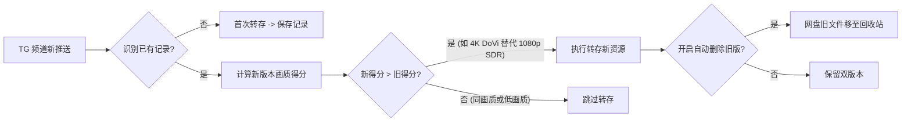

# 123云盘TG转存助手 (Pan123TgPilot)

`Pan123TgPilot` 是专为 **MoviePilot V3** 深度定制的 123 云盘 Telegram 影视频道智能自动转存与画质洗版插件。

---

## 1. 核心定位与解决痛点

在影视资源日常追更中，各大 Telegram 影视发布频道（如电影、剧集、国漫、新番等分享频道）每天都会推送海量 123 云盘标准分享链接与秒传链接。传统人工盯频道、点开转存、手动整理不仅费时费力，且往往面临以下痛点：
1. **电影与剧集混杂**：所有资源混在一个目录，无法自动归类到 Emby / Jellyfin 的 Movie 与 TV 库中。
2. **多链接格式异构**：有带提取码的标准 URL（如 `https://www.123pan.com/s/...`），也有秒传码（如 `123FSLinkV2$...`），缺少统一自动化转存工具。
3. **资源版本迭代低质**：早先转存了 1080p 或压缩版，后期频道更新了 4K、DoVi（杜比视界）、Remux 等高规格画质版本，人工难以实时比对洗版，旧资源占用空间且无法及时更替。
4. **网络限制与配置繁琐**：国内直连 TG 频道通常受限，需要灵活的代理适配；同时免去复杂的 Telegram Bot 创建与申请，开箱即用。

**Pan123TgPilot** 彻底解决上述痛点，实现：**“自动监听 TG 频道 → 结构化提取元数据 → 电影/电视剧自动分流 → 秒传/分享一键转存 → 画质智能多维评分与自动洗版升级 → 旧版本自动清理 → MoviePilot 消息推送”** 的全自动闭环。

---

## 2. 主要功能特性

- **多频道全天候巡检**：
  - 支持配置任意数量的公开 Telegram 影视频道（如 `@Pan123Movie, @regeng123, @yun123pan`）。
  - 支持基于 `t.me/s/` 公开流无鉴权解析，免去注册 Telegram Bot、API ID 的繁杂流程；同时提供可选的 Telegram Bot Token 兼容支持。
  - 内置网络代理（HTTP / SOCKS5）配置，适配各种网络环境。

- **多模式链接全适配**：
  - **123 云盘标准分享链接**：智能提取带 `?pwd=...` 的分享 URL 或从正文提取码中解析密码，一键免鉴权转存。
  - **123FSLinkV2 秒传链接**：自动解构 `123FSLinkV2$<md5>#<size>#<filename>`，调用原生 Web 秒传接口实现零流量毫秒级转存。

- **电影与剧集精准分流**：
  - 深度识别影视名称、首播年份、TMDB ID 与季集信息（`S01E01`、`S05E217`、`第1季` 等）。
  - 自动识别 TMDB 权威链接 `/movie/` 与 `/tv/`，结合中英文标签判定媒体属性。
  - 电影类自动转存至用户指定的**电影转存目录 ID**，电视剧集类自动转存至**剧集转存目录 ID**。

- **画质洗版升级 (Auto-Upgrading)**：
  - 内置多维画质评分体系：
    - **分辨率权重**：2160p (4K) 100分 > 1080p 60分 > 720p 30分 > 480p 10分。
    - **动态范围加成**：DoVi (杜比视界) +25分 > HDR10+ / HDR +15分。
    - **编码格式加成**：H.265 / HEVC / AV1 +15分 > H.264 / AVC +5分。
    - **制作来源加成**：BluRay / Remux +20分 > WEB-DL +10分 > HDTV +5分。
    - **文件体积加权**：按文件大小阶梯累加，保障码率充沛。
  - 发现同剧集/电影的更高画质新版本时，自动触发洗版转存；若开启“洗版清理旧版本”，将自动将网盘中低画质旧版移入回收站，节省网盘宝贵存储。

- **转存状态持久化与去重**：
  - 本地独立 SQLite 数据表记录已转存资源的唯一媒体标识（`media_key`）、质量评分、云盘文件 ID 与转存时间，防止重复转存。

- **MoviePilot 系统通知联动**：
  - 转存成功或洗版升级后，可按需向 MoviePilot 绑定的通知渠道（微信、Telegram、企业微信等）推送精美卡片消息，包含影视名、年份、画质规格、体积与洗版情况。默认不开启通知，保持静默。

---

## 3. 配置项详尽说明

在 MoviePilot 插件管理界面中，可配置以下参数：

| 参数名称 | 表单字段 | 类型 | 默认值 | 取值范围 / 说明 |
| :--- | :--- | :--- | :--- | :--- |
| **启用插件** | `enabled` | 布尔值 (Switch) | `false` | 是否开启 TG 频道自动转存服务 |
| **立即运行一次** | `run_now_on_save` | 布尔值 (Switch) / 按钮 | `false` | 保存配置时立刻在后台执行一次全量频道巡检与转存测试，无需等待定时周期 |
| **发送转存成功通知** | `notify_enabled` | 布尔值 (Switch) | `false` | 转存或洗版成功后是否通过 MoviePilot 消息渠道发送通知，默认关闭 |
| **123 云盘 Web Token** | `pan123_token` | 字符串 (Password) | `空` | 123 云盘网页版 Authorization / Token（必填） |
| **电影转存目录 ID** | `movie_target_dir_id` | 整数 / 文本 | `0` | 存放电影的 123 云盘目录 FileID（0 代表网盘根目录） |
| **电视剧集转存目录 ID** | `tv_target_dir_id` | 整数 / 文本 | `0` | 存放电视剧集与动漫剧集的 123 云盘目录 FileID |
| **监控 TG 频道列表** | `tg_channels` | 文本 (Textarea) | `@Pan123Movie, @regeng123, @yun123pan` | 多个频道用英文逗号或换行分隔，支持 `@频道名` 或纯频道名 |
| **抓取检查周期 (分钟)** | `check_interval` | 整数 (Number) | `10` | 周期性巡检频道的频率，推荐 5 ~ 30 分钟 |
| **TG 网络代理** | `tg_proxy` | 字符串 | `空` | HTTP / SOCKS5 代理地址，如 `http://127.0.0.1:7890`（国内服务器必填） |
| **开启智能画质洗版** | `auto_upgrade` | 布尔值 (Switch) | `true` | 当检测到同一影视且画质评分更高时，自动转存新资源 |
| **洗版成功后清理旧版** | `auto_delete_old_version` | 布尔值 (Switch) | `true` | 洗版成功后，自动将网盘中旧版文件移至回收站 |
| **Telegram Bot Token** | `tg_bot_token` | 字符串 (Password) | `空` | 高级备用选项。留空时默认通过公开流免鉴权解析；如配置则通过官方 Bot API 读取 |

---

## 4. 实战配置教程与示例

### 步骤一：获取 123 云盘 Web Token
1. 使用电脑浏览器打开 [123pan.com](https://www.123pan.com) 并登录账号。
2. 按 `F12` 打开开发者工具，切换到 **网络 (Network)** 标签页。
3. 在网页中刷新一下或点击任一文件夹，在请求列表中找到包含 `123pan.com/b/api/...` 的任意请求。
4. 查看该请求的 **请求标头 (Request Headers)**，复制 `authorization` 或 `authorToken` 的值（例如 `ey...` 或 `Bearer ey...`）。
5. 粘贴到插件配置项 **123 云盘 Web Token** 中。

### 步骤二：获取电影与剧集转存目录 ID
1. 在 123 云盘网页版中，分别进入你准备用于存放电影和电视剧的文件夹。
2. 查看浏览器地址栏 URL：
   - 示例：`https://www.123pan.com/folder/17439195`
   - 则该目录 ID 即为 `17439195`。
3. 分别将对应的数字填入 **电影转存目录 ID** 和 **电视剧集转存目录 ID**。

### 步骤三：配置 TG 频道与网络代理
1. **频道配置**：填入你常关注的 123 影视分享频道，例如：
   ```text
   @Pan123Movie, @regeng123, @yun123pan
   ```
2. **代理配置**（国内 NAS / 服务器）：
   - 若机器无法直接访问 `t.me`，在 **Telegram 网络代理** 填入宿主机代理端口，如 `http://127.0.0.1:7890` 或 `http://192.168.1.100:7890`。

---

## 5. 画质智能洗版评分机制

插件内置严格的画质等级计算器，自动根据 Telegram 消息特征评分：



- **洗版实例**：
  - 第一次频道推送《八仙！ (2026)》1080p WEB-DL H.264（得分约 75 分），插件自动转存至电影目录；
  - 随后频道推送《八仙！ (2026)》2160p 4K WEB-DL H.265 DoVi 杜比视界 30.6GB（得分约 150 分）；
  - 插件识别出画质升级，自动转存 4K 版本，并将 1080p 旧文件移入 123 云盘回收站，发送洗版成功通知。

---

## 6. 版本历史 (Changelog)

### v1.0.6
- **目录容错回退、跨频道精准去重与数据清单检索界面**：
  - **网盘目标目录不存在自动优雅回退**：彻底解决因在 123 云盘网页端删除了目录（如 `42149741`）导致转存报错 `秒传转存失败: 文件夹不存在` 的痛点。插件自动侦测目标目录异常，并在网盘根目录自动创建影视同名归集文件夹重试转存，保障转存 100% 成功，并在日志中输出友好排查指引。
  - **跨频道与多版本精准去重**：重构媒体唯一标识提取机制，采用统一规范的标题与年份/季集作为核心媒体键（如 `movie_八仙_2026`），辅以 TMDB ID 多条件关联比对，彻底解决同一部电影在不同频道发布（一个附带 TMDB 链接、另一个无链接）被重复转存的问题。未达洗版条件坚决不重复转存。
  - **全链路链接与秒传码去重校验**：新增链接级指纹库，覆盖原始分享链接、短码、秒传码全文以及秒传文件哈希，对已处理过的资源快速跳过，避免无谓的网络请求。
  - **详情页新增「已转存影视资源数据清单」展示**：内置全功能数据表格，清晰直观展示已转存的全部影视资源，标注影视名称、分辨率、编码格式、HDR/DoVi 规格、文件大小、质量评分、来源频道、转存类型（首发转存 / 洗版升级）及转存时间。
  - **支持关键字检索与 /records API**：数据库与 API 支持传入 `keyword` 对影视名称、分辨率、编码、来源频道等进行模糊搜索。

### v1.0.5
- **数据库装饰器兼容与秒传扩展名修复**：
  - **修复数据库装饰器注入冲突**：彻底重构 `Pan123TgDatabase` 的数据库门面方法，采用自适应变长参数处理机制，彻底解决 MoviePilot V3 核心 `@db_query` 装饰器自动注入 session 时引发的 `Pan123TgDatabase.get_record_by_media_key() got multiple values for argument 'media_key'` 报错。
  - **修复带空格秒传文件名截断与扩展名丢失**：重写 `123FSLinkV2` 正则规则与解析器，完整支持带空格、年份、清晰度修饰词的文件名，自动清洗剥离句末中文标点（句号 `。`），并提供扩展名兜底保护。
  - **优化网络日志**：移除未配代理时的静态警告，境外服务器（如韩国机房）直连访问 Telegram 时日志更加清爽。

### v1.0.4
- **秒传格式与文件扩展名修复**：
  - **修复空格截断与后缀丢失缺陷**：彻底修复原 `123FSLinkV2` 正则因排斥空格字符导致带有空格的文件名（如 `八仙！ (2026) - 2160p...mkv`）在遇到首个空格时被提前截断、进而造成 `.mkv`/`.mp4` 后缀名完全丢失的严重问题。
  - **清洗尾部中文标点与符号**：自动清洗剥离消息句末的中文标点（如句号 `。`、逗号 `，`）及多余括号，杜绝文件名生成为 `xxx.mkv。` 的异常。
  - **扩展名兜底保护**：若原始发布文本缺失后缀，自动智能补齐 `.mkv`，确保转存到网盘后能被 Emby / Jellyfin 正常识别与刮削。

### v1.0.3
- **全量转存与伴生文件增强**：
  - **优先级策略调整**：当 Telegram 消息中同时包含完整分享链接（`https://www.123pan.com/s/...`）和单文件秒传链接（`123FSLinkV2$...`）时，**绝对优先执行完整分享链接转存**，彻底解决以往因优先秒传单文件导致刮削文件遗漏的问题。
  - **完整同步刮削与伴生文件**：转存分享链接时，自动遍历并同步转存分享文件夹内的**全部内容**，包括视频主文件、各语言字幕文件（`.srt`、`.ass`、`.vtt` 等）、NFO 刮削元数据文件（`.nfo`）以及海报/剧照图片（`.jpg`、`.png` 等）。
  - **平铺散落文件智能归集**：针对直接分享散落文件（未预先放入文件夹）的分享链接，自动在网盘电影/剧集目标目录下创建影视同名子文件夹（如 `八仙！ (2026)`），并将所有文件一并转存至该专属子目录中，保持媒体库整洁规范。
  - **秒传归集**：单文件秒传转存同样支持自动创建同名子文件夹归集存放。

### v1.0.2
- **网络连接与代理增强**：
  - 增强网络通道，优先使用 requests 并配合智能重试与自动格式补全。
  - 自动继承 MoviePilot 全局代理设置与容器环境变量代理。
  - 优化 TLS 握手超时排查日志，精准指引 Docker 容器环境代理配置 (区分 127.0.0.1 与宿主机局域网 IP)。

### v1.0.1
- **修复与功能增强**：
  - 修复 `save_or_update_record` 在转存成功后写入 SQLite 数据库时因关键字参数不匹配引发的异常。
  - 插件配置表单与详情页新增**「立即运行一次」**一键测试按钮，新增**「保存配置后立即运行一次」**开关选项，随时手动触发全量巡检测试。
  - 注册 `/pan123_tg_run` 远程动作命令，支持多端随时下发立即执行。

### v1.0.0
- **首发正式版发布**：
  - 支持 Telegram 公开影视频道实时抓取与免 Bot 网页流解析。
  - 智能解析影视标题、首播年份、TMDB ID 及季集信息（`SxxExx`）。
  - 精准区分电影与剧集，自动分流转存至配置的 123 云盘目录。
  - 全面支持 123 云盘网页端标准分享链接（含密码自动解析）与 `123FSLinkV2` 秒传链接。
  - 引入多维画质评分引擎（分辨率、杜比视界/HDR、编码格式、制作来源、文件体积）。
  - 支持智能画质洗版升级，新高画质版本自动覆盖转存，支持自动清理旧版本文件。
  - 提供 MoviePilot 系统通知与 API 调试端点。
