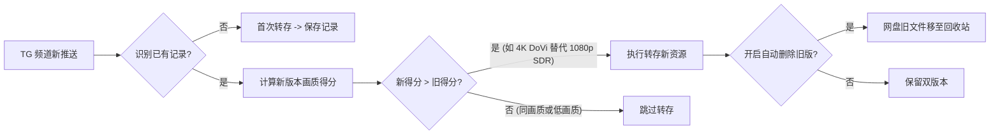

# 123云盘TG转存助手 (Pan123TgPilot)

`Pan123TgPilot` 是专为 **MoviePilot V3** 深度定制的 123 云盘 Telegram 影视频道智能自动转存与画质洗版插件。

---

## 1. 核心定位与解决痛点

在影视资源日常追更中，各大 Telegram 影视发布频道（如电影、剧集、国漫、新番等分享频道）每天都会推送海量 123 云盘标准分享链接与秒传链接。传统人工盯频道、点开转存、手动整理不仅费时费力，且往往面临以下痛点：
1. **电影与剧集混杂**：所有资源混在一个目录，无法自动归类到 Emby / Jellyfin 的 Movie 与 TV 库中。
2. **多链接格式异构**：有带提取码的标准 URL（如 `https://www.123pan.com/s/...`），也有秒传码（如 `123FSLinkV2$...`），缺少统一自动化转存工具。
3. **资源版本迭代低质**：早先转存了 1080p 或压缩版，后期频道更新了 4K、DoVi（杜比视界）、Remux 等高规格画质版本，人工难以实时比对洗版，旧资源占用空间且无法及时更替。
4. **网络限制与配置繁琐**：国内直连 TG 频道通常受限，需要灵活的代理适配；同时免去复杂的 Telegram Bot 创建与申请，开箱即用。

**Pan123TgPilot** 彻底解决上述痛点，实现：**“自动监听 TG 频道 → 结构化提取元数据 → 电影/电视剧自动分流 → 秒传/分享一键转存 → 画质智能多维评分与自动洗版升级 → 旧版本自动清理 → MoviePilot 消息推送”** 的全自动闭环。

---

## 2. 主要功能特性

- **多频道全天候巡检**：
  - 支持配置任意数量的公开 Telegram 影视频道（如 `@Pan123Movie, @regeng123, @yun123pan`）。
  - 支持基于 `t.me/s/` 公开流无鉴权解析，免去注册 Telegram Bot、API ID 的繁杂流程；同时提供可选的 Telegram Bot Token 兼容支持。
  - 内置网络代理（HTTP / SOCKS5）配置，适配各种网络环境。

- **多模式链接全适配**：
  - **123 云盘标准分享链接**：智能提取带 `?pwd=...` 的分享 URL 或从正文提取码中解析密码，一键免鉴权转存。
  - **123FSLinkV2 秒传链接**：自动解构 `123FSLinkV2$<md5>#<size>#<filename>`，调用原生 Web 秒传接口实现零流量毫秒级转存。

- **电影与剧集精准分流**：
  - 深度识别影视名称、首播年份、TMDB ID 与季集信息（`S01E01`、`S05E217`、`第1季` 等）。
  - 自动识别 TMDB 权威链接 `/movie/` 与 `/tv/`，结合中英文标签判定媒体属性。
  - 电影类自动转存至用户指定的**电影转存目录 ID**，电视剧集类自动转存至**剧集转存目录 ID**。

- **画质洗版升级 (Auto-Upgrading)**：
  - 内置多维画质评分体系：
    - **分辨率权重**：2160p (4K) 100分 > 1080p 60分 > 720p 30分 > 480p 10分。
    - **动态范围加成**：DoVi (杜比视界) +25分 > HDR10+ / HDR +15分。
    - **编码格式加成**：H.265 / HEVC / AV1 +15分 > H.264 / AVC +5分。
    - **制作来源加成**：BluRay / Remux +20分 > WEB-DL +10分 > HDTV +5分。
    - **文件体积加权**：按文件大小阶梯累加，保障码率充沛。
  - 发现同剧集/电影的更高画质新版本时，自动触发洗版转存；若开启“洗版清理旧版本”，将自动将网盘中低画质旧版移入回收站，节省网盘宝贵存储。

- **转存状态持久化与去重**：
  - 本地独立 SQLite 数据表记录已转存资源的唯一媒体标识（`media_key`）、质量评分、云盘文件 ID 与转存时间，防止重复转存。

- **MoviePilot 系统通知联动**：
  - 转存成功或洗版升级后，可按需向 MoviePilot 绑定的通知渠道（微信、Telegram、企业微信等）推送精美卡片消息，包含影视名、年份、画质规格、体积与洗版情况。默认不开启通知，保持静默。

---

## 3. 配置项详尽说明

在 MoviePilot 插件管理界面中，可配置以下参数：

| 参数名称 | 表单字段 | 类型 | 默认值 | 取值范围 / 说明 |
| :--- | :--- | :--- | :--- | :--- |
| **启用插件** | `enabled` | 布尔值 (Switch) | `false` | 是否开启 TG 频道自动转存服务 |
| **立即运行一次** | `run_now_on_save` | 布尔值 (Switch) / 按钮 | `false` | 保存配置时立刻在后台执行一次全量频道巡检与转存测试，无需等待定时周期 |
| **发送转存成功通知** | `notify_enabled` | 布尔值 (Switch) | `false` | 转存或洗版成功后是否通过 MoviePilot 消息渠道发送通知，默认关闭 |
| **123 云盘 Web Token** | `pan123_token` | 字符串 (Password) | `空` | 123 云盘网页版 Authorization / Token（必填） |
| **电影转存目录 ID** | `movie_target_dir_id` | 整数 / 文本 | `0` | 存放电影的 123 云盘目录 FileID（0 代表网盘根目录） |
| **电视剧集转存目录 ID** | `tv_target_dir_id` | 整数 / 文本 | `0` | 存放电视剧集与动漫剧集的 123 云盘目录 FileID |
| **监控 TG 频道列表** | `tg_channels` | 文本 (Textarea) | `@Pan123Movie, @regeng123, @yun123pan` | 多个频道用英文逗号或换行分隔，支持 `@频道名` 或纯频道名 |
| **抓取检查周期 (分钟)** | `check_interval` | 整数 (Number) | `10` | 周期性巡检频道的频率，推荐 5 ~ 30 分钟 |
| **TG 网络代理** | `tg_proxy` | 字符串 | `空` | HTTP / SOCKS5 代理地址，如 `http://127.0.0.1:7890`（国内服务器必填） |
| **开启智能画质洗版** | `auto_upgrade` | 布尔值 (Switch) | `true` | 当检测到同一影视且画质评分更高时，自动转存新资源 |
| **洗版成功后清理旧版** | `auto_delete_old_version` | 布尔值 (Switch) | `true` | 洗版成功后，自动将网盘中旧版文件移至回收站 |
| **Telegram Bot Token** | `tg_bot_token` | 字符串 (Password) | `空` | 高级备用选项。留空时默认通过公开流免鉴权解析；如配置则通过官方 Bot API 读取 |
| **记录保留天数** | `retention_days` | 整数 (Number) | `0` | `0` 表示永久保留；填 N 则每天 03:00 自动清理 `updated_at` 早于 N 天的转存记录。注意：清理后同一资源再次出现可能被重新转存 |
| **消息并发转存数** | `msg_concurrency` | 整数 (Number) | `3` | 同时并发处理多少条 TG 频道消息（取值范围 `1~8`，推荐 `2~4`，填 `1` 退回单线程串行） |
| **单分享内文件并发数** | `file_concurrency` | 整数 (Number) | `4` | 单个多集剧集分享内部同时秒传多少个文件（取值范围 `1~8`，推荐 `3~5`，大幅加速多集剧集转存） |
| **启用 pan1.me 监控** | `pan1me_enabled` | 布尔值 (Switch) | `false` | 是否同步巡检 `pan1.me` (Xiuno BBS) 论坛影视板块 |
| **每日自动签到** | `pan1me_auto_checkin` | 布尔值 (Switch) | `true` | 每天首次巡检自动完成论坛每日签到赚取金币/积分 |
| **自动回复解锁隐藏贴** | `pan1me_auto_reply` | 布尔值 (Switch) | `true` | 遇到「回复可见」且未解锁的新帖时自动礼貌回复解锁 (按轮限流防封) |
| **论坛地址** | `pan1me_url` | 字符串 | `https://pan1.me` | 论坛根地址 |
| **监控板块 ID / 链接** | `pan1me_forum_ids` | 字符串 | `2,48,37,52` | `2`=电影, `48`=电视剧, `37`=动漫, `52`=综艺；支持填纯 ID 或完整 `?forum-X.htm` URL |
| **论坛账号 / 邮箱** | `pan1me_username` | 字符串 | `空` | 用于登录论坛、每日签到与回复解锁 |
| **论坛密码** | `pan1me_password` | 字符串 (Password) | `空` | 论坛登录密码 |
| **备用登录 Cookie** | `pan1me_cookie` | 字符串 (Password) | `空` | 当登录触发图形验证码时，可直接填入浏览器 F12 复制的 Cookie 维持会话 |
| **单轮最多自动回复贴数** | `pan1me_max_reply_per_run` | 整数 (Number) | `3` | 防灌水封号上限，限制单次巡检最多回复多少贴 (范围 `0~20`) |
| **每日最多自动回复贴数** | `pan1me_daily_reply_limit` | 整数 (Number) | `10` | 防止触及账号每日回帖封顶 (范围 `0~100`，`0` 为不另设本地上限；触及站方今日上限时也会自动当日熔断、次日恢复) |
| **论坛关键词过滤** | `pan1me_keywords` | 文本 (Textarea) | `空` | 留空抓取全部新帖；填写关键词 (逗号分隔) 则仅处理命中片名 |

---

## 4. 实战配置教程与示例

### 步骤一：获取 123 云盘 Web Token
1. 使用电脑浏览器打开 [123pan.com](https://www.123pan.com) 并登录账号。
2. 按 `F12` 打开开发者工具，切换到 **网络 (Network)** 标签页。
3. 在网页中刷新一下或点击任一文件夹，在请求列表中找到包含 `123pan.com/b/api/...` 的任意请求。
4. 查看该请求的 **请求标头 (Request Headers)**，复制 `authorization` 或 `authorToken` 的值（例如 `ey...` 或 `Bearer ey...`）。
5. 粘贴到插件配置项 **123 云盘 Web Token** 中。

### 步骤二：获取电影与剧集转存目录 ID
1. 在 123 云盘网页版中，分别进入你准备用于存放电影和电视剧的文件夹。
2. 查看浏览器地址栏 URL：
   - 示例：`https://www.123pan.com/folder/17439195`
   - 则该目录 ID 即为 `17439195`。
3. 分别将对应的数字填入 **电影转存目录 ID** 和 **电视剧集转存目录 ID**。

### 步骤三：配置 TG 频道与网络代理
1. **频道配置**：填入你常关注的 123 影视分享频道，例如：
   ```text
   @Pan123Movie, @regeng123, @yun123pan
   ```
2. **代理配置**（国内 NAS / 服务器）：
   - 若机器无法直接访问 `t.me`，在 **Telegram 网络代理** 填入宿主机代理端口，如 `http://127.0.0.1:7890` 或 `http://192.168.1.100:7890`。

---

## 5. 画质智能洗版评分机制

插件内置严格的画质等级计算器，自动根据 Telegram 消息特征评分：



- **洗版实例**：
  - 第一次频道推送《八仙！ (2026)》1080p WEB-DL H.264（得分约 75 分），插件自动转存至电影目录；
  - 随后频道推送《八仙！ (2026)》2160p 4K WEB-DL H.265 DoVi 杜比视界 30.6GB（得分约 150 分）；
  - 插件识别出画质升级，自动转存 4K 版本，并将 1080p 旧文件移入 123 云盘回收站，发送洗版成功通知。

---

### 数据存储、分页与保留策略

- 记录存放在 MoviePilot 宿主数据库的自有表 `plugin_pan123_tg_record` 中（`link_hash`、`updated_at`、`status` 等均有索引），无需额外数据库文件。
- 链接去重基于带索引的 `link_hash`（分享链接短码 `s:<key>` / 秒传文件哈希 `f:<etag>`），不再使用全表 `LIKE` 扫描。
- 升级到 v1.1.0 时自动执行可重复运行的迁移：补齐 `link_hash` 列与索引并回填历史数据。
- 详情页清单：采用与 123云盘助手同款的现代化交互式分页导航栏（支持首页/上一页/页码直跳/下一页/末页/快进快退 5 页、每页 15/20/50 条切换）及顶部媒体分类/状态筛选工具栏。
- 完整检索与翻页使用 API：`GET /api/v1/plugin/Pan123TgPilot/records?keyword=八仙&status=saved&page=1&page_size=20`，返回 `total` / `pages` / `data`。
- 手动清理：`/purge`（保留天数为 0 时不会删除任何数据）。

## 6. 版本历史 (Changelog)

### v1.3.2
- **新增 `pan1.me` 每日回帖限额控制与站方上限当日熔断保护**：
  - **每日回帖配额持久化**：新增配置项「每日最多自动回复贴数」（`pan1me_daily_reply_limit`，默认 `10` 贴/天），通过持久化记录跨重启统计今日已回复数，避免高频回帖触及账号上限。
  - **站方上限自动熔断与次日恢复**：一旦站点返回「您的用户今日回帖数达到上限」等提示，立即熔断当天剩余自动回帖（不再无效刷回帖或拿无密码链接试错报错），仅继续抓取公开直出 123 链接，未解锁帖保留等待次日 00:00 自动恢复解锁。
  - **详情页状态可视化**：在详情页看板展示今日回帖计数与上限熔断状态。
  - **既有核心增强**：支持「公开链接 + 隐藏提取码」自动解锁、全板块抓取与每日自动签到、`SXXEXX-EXX` 追更补全与电影排他判定。
